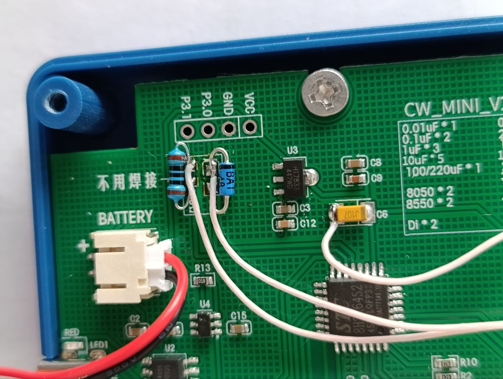

# Firmware download

This guide tells you how to connect the trainer to a computer and download the firmware into the MCU.

> [!WARNING]
> If you want to keep the original firmware, do not download this firmware. The download erases the original
> firmware. No copy of it is available, so you cannot restore it.

## What you need

- A USB-to-serial adapter (USB2UART).
- A Schottky diode. The MCU datasheet recommends the 1N5819, but a generic Schottky diode also works. The photo
  below shows a BAT48.
- A 100 Ω resistor.
- A computer with the tools from [Prerequisites](../README.md#prerequisites).

## Connection

The programming header is next to the battery connector. It has four pads, marked `P3.1`, `P3.0`, `GND` and `VCC`.
Connect three lines only:

| Trainer pad | Part in the line | Adapter pin |
|---|---|---|
| `P3.0` (MCU RXD) | Schottky diode, cathode (band) to the adapter | `TX` |
| `P3.1` (MCU TXD) | 100 Ω resistor | `RX` |
| `GND` | Wire | `GND` |
| `VCC` | Not connected | |

The trainer gets power from its battery. The adapter `TX` pin stays high between bytes. Without the diode,
this pin can supply the MCU through `P3.0`, and the MCU does not switch off fully. The MCU starts its download mode only
after a full power-off. The resistor limits the current on the `P3.1` line. The MCU datasheet shows this circuit in
section 5.1.4.



The photo shows the lines with through-hole parts: a 100 Ω resistor on `P3.1` and a BAT48 Schottky diode on `P3.0`.

## Download

1. Switch off the trainer.
2. Connect the adapter to the trainer as the table shows.
3. Connect the adapter to the computer. Find the name of its serial port, for example `/dev/ttyUSB0`.
4. From the repository root, run the download script with the port name:

   ```sh
   ./firmware/flash.sh /dev/ttyUSB0
   ```

5. When the script shows `Power-cycle the trainer when stcgal waits for the MCU.`, switch on the trainer.
6. Wait until `stcgal` finishes.
7. Switch the trainer off and on. The startup screen shows the new firmware version.

The download keeps your settings and your training levels. If the download fails, read
[Download firmware](../README.md#download-firmware).
